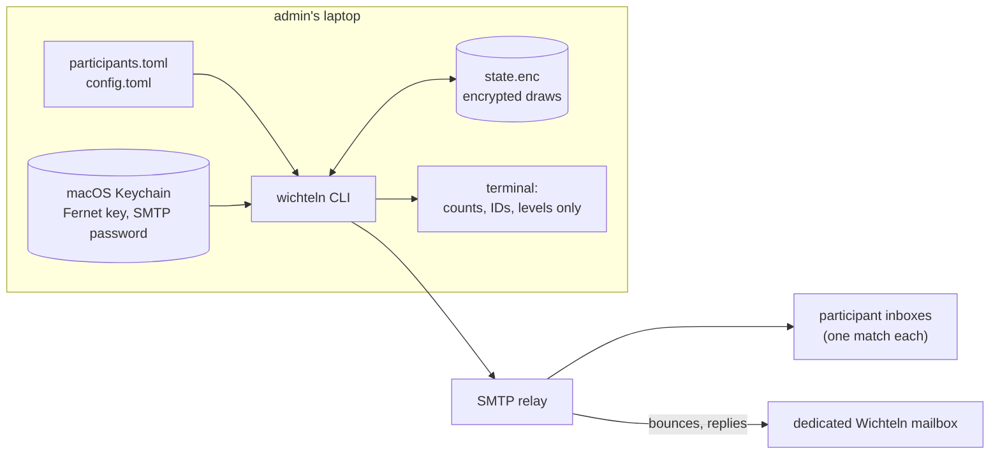

# Wichteln

A small command-line tool that runs the family's yearly Secret Santa draw on the admin's
Mac. It keeps a participant list, picks a valid draw that avoids the matches of the two
previous years, and emails each person only the name of the person they give a gift to.
The admin never sees a match: the terminal shows only counts, IDs and levels, and every
draw is stored encrypted.



The design is in [`docs/designs/wichteln.md`](docs/designs/wichteln.md).

## Install

```sh
uv python install 3.12
uv tool install --python 3.12 --managed-python .
```

## Prerequisites

- **SMTP account** at any provider, entered in `config.toml`. Use an account only for
  Wichteln, and don't routinely read its mailbox, including the Sent folder, replies and
  bounces. They can quote matches.
- **Spam protection:** set up SPF, DKIM and DMARC for the sending domain, where the
  provider allows it.
- **Backup:** check that the laptop backup (for example Time Machine) covers the data
  folder.

## First-time setup

1. Run `wichteln init`. Store the printed key in your password manager, then clear the
   terminal scrollback (Cmd-K).
2. Add the SMTP password:

   ```sh
   security add-generic-password -s wichteln -a smtp -U -w
   ```

   It prompts for the password. The password must be printable ASCII, because
   `security -w` prints other passwords as hex.
3. Edit `participants.toml` and `config.toml` in the data folder.

## Data folder

`~/Wichteln` by default; set `WICHTELN_HOME` to use another folder.

| File | Content |
|---|---|
| `participants.toml` | Plain text, edited by hand: `id`, `name`, `email` per participant. The `id` is fixed and never reused. |
| `config.toml` | Plain text, no secrets: SMTP host, port (465 or 587), username, sender, reply and bounce addresses, optional `event_line`. |
| `state.enc` | Encrypted (Fernet): every draw and send result. The key is in the macOS Keychain. |

## Commands

| Command | What it does |
|---|---|
| `wichteln init` | Creates the data folder, example files, key and empty state. |
| `wichteln preflight [--test-email]` | Checks files, key, state, SMTP login and whether a draw exists. `--test-email` sends everyone a test email without a match. |
| `wichteln draw [--redraw] [--no-history] [--yes]` | Makes this year's draw and emails everyone. |
| `wichteln send [<id>]` | Sends pending emails, or one participant's email again. |
| `wichteln dropout <id> [--yes]` | Removes a participant after the draw. |
| `wichteln status` | Shows the send result per participant ID. |
| `wichteln import <file>` | Adds an earlier year's draw as history, so its matches aren't repeated. |

Exit codes: 0 success, 1 usage or input error (or failed `preflight`), 2 some emails
failed, 3 state, key or Keychain error.

## Importing earlier draws

Draws made before the tool (on paper or elsewhere) can be added as history, so
`draw` avoids repeating them. Write a TOML file **outside** any git repository:

```toml
year = 2025

[pairs]            # giver ID = recipient ID
p1 = "p2"
p2 = "p5"          # p5 and p6 took part in 2025 but not this year
p5 = "p3"
p3 = "p4"
p4 = "p6"
p6 = "p1"
```

Use the same IDs as in `participants.toml`. People who don't take part this year still
need an ID; keep it for them if they come back. Every giver must appear exactly once as
a recipient. Then:

```sh
wichteln import draw-2025.toml
rm draw-2025.toml
```

Only years before the current one can be imported, one draw per year. An imported draw
is history only: `send` and `dropout` refuse it until this year's `draw` exists.
Matches with people who don't take part this year simply never come up.

## Yearly runbook

1. In November, at least two weeks before the planned draw, run `wichteln preflight`.
   If the tool fails to start, run
   `uv tool install --reinstall --python 3.12 --managed-python .`.
2. Update `participants.toml`.
3. Run `wichteln preflight --test-email` and fix any bounced addresses.
4. In the family chat, ask everyone to confirm they received the test email, check their
   spam folder, and add the sender to their contacts.
5. Run `wichteln draw` once everyone has confirmed.
6. When someone drops out, run `wichteln dropout <id>` and tell them directly.
7. When someone loses their email, run `wichteln send <id>`.
8. After the gift exchange, delete everything in the Wichteln mailbox, including the
   Sent folder, without opening it, or turn on the provider's automatic deletion. It may
   hold late bounces and replies that quote matches.

## Recovery

- **Lost Keychain key:** restore it from the password manager with
  `security add-generic-password -s wichteln -a fernet-key -U -w`, which prompts for it.
- **Key lost for good:**
  1. Move `state.enc` out of the data folder.
  2. If a damaged key is still in the Keychain, run
     `security delete-generic-password -s wichteln -a fernet-key`.
  3. Run `wichteln init` and store the new key in the password manager.
  4. Run `wichteln draw`. History is empty, so no earlier matches are excluded this year.
- **Damaged `state.enc`:** restore it from the laptop backup.
- **`keychain access failed (exit N)`:** unlock the login keychain, or run the command from
  a logged-in desktop session, then try again.
- **`smtp: FAILED (connect failed (SSLCertVerificationError))` in `preflight`:** run the
  command with `SSL_CERT_FILE=/etc/ssl/cert.pem`, the macOS system certificates.
- **`internal error: <Class>`:** run `uv run pytest` in this repository to find the broken
  part. Tracebacks aren't shown, because they can contain matches.

## Development

```sh
uv sync
uv run pytest --cov=wichteln --cov-report=term-missing --cov-fail-under=85
uv run coverage report --include="src/wichteln/solver.py,src/wichteln/splice.py,src/wichteln/rules.py" --fail-under=100
uv run ruff check .
uv run ruff format --check .
```
